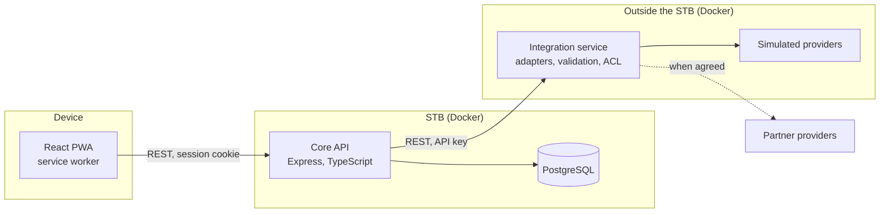

# Architecture

## System



The paper's Figure 1 and the course rule place cross-group orchestration outside the STB, so the integration service is a separate deployable rather than a module of the core API.

## Repository

```text
apps/api            Core service: contexts, catalog client, Prisma schema, tests
apps/integration    Provider adapters, ACL, last-good cache, tests
apps/provider-sim   Simulated partners with failure drills
apps/web            React PWA in Bahasa Indonesia
packages/shared     Zod schemas and types used across services
e2e                 Playwright journeys and accessibility checks
scripts             Local database and setup helpers
```

## Technology

| Concern | Choice | Reason |
|---|---|---|
| Client | React, Vite, React Router | Installable responsive PWA from one codebase |
| API | Express 5, TypeScript | Proposed stack, with native async error handling |
| Data | PostgreSQL, Prisma 6 | Relational integrity and migrations |
| Validation | Zod | One schema for forms, API, and provider data |
| Passwords | Node `scrypt` | Strong hashing with no native dependency |
| Sessions | Random token in an HttpOnly cookie, stored hashed | Revocable, and a database leak exposes no usable token |
| Typeface | Atkinson Hyperlegible, bundled | Designed for legibility and available offline |

## Integration flow

1. The core requests catalog data with only skill code, level, and format.
2. The integration service applies a timeout and bounded retries, and honors `Retry-After`.
3. Responses are validated per record. The ACL converts provider DTOs to internal types and rejects unsafe media URLs.
4. If a provider fails, the service returns its last good copy when one is still fresh.
5. The core validates the response and stores it in `material_cache` or `activity_cache`.
6. If the integration service is down, the core uses valid stored items. A skill with none is postponed with a clear message.

## Error handling

| Failure | Behavior |
|---|---|
| Invalid input | 400 with field details |
| Missing session | 401 |
| Another caregiver's record | 404, so its existence is not confirmed |
| Invalid state or reused key | 409 |
| Provider timeout, 429, 5xx, or bad data | Logged, then stored data is used |
| No activity available | 503 `ACTIVITIES_UNAVAILABLE`, with progress untouched |
| Lost connection while answering | The client resends with the same idempotency key |

## Offline behavior

The service worker caches the app shell and the non-personal list of stored materials. Child data, sessions, and progress are never cached in the browser. Starting a session and saving answers still require a connection to the STB.

## Security

Passwords are hashed, cookies are HttpOnly and `SameSite=Strict`, authorization runs on the server, login is rate limited, and security headers come from Helmet. Answer rules never leave the server. Secrets are read from the environment.
