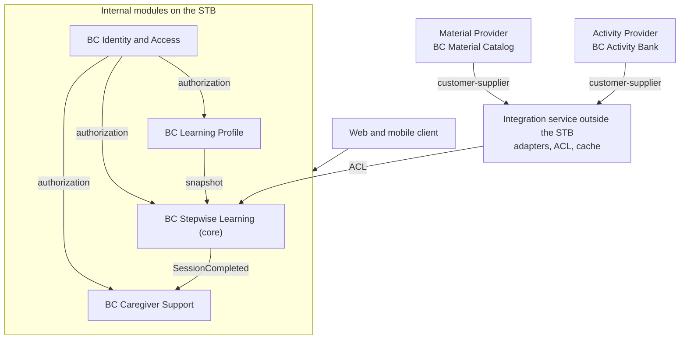

# Domain-Driven Design

This document maps the paper's model to the code. Development uses the English names listed in [AGENTS.md](../AGENTS.md).

## Context map

Arrows show data flow or access dependency, not shared table access. The gateway and client are technical components, not bounded contexts.

## Bounded contexts in code

| Context | Type | Code | Owns |
|---|---|---|---|
| Stepwise Learning | Core | `apps/api/src/contexts/learning` | `LearningSession`, `SessionStep`, `ExerciseResult`, `SkillMastery` |
| Learning Profile | Supporting | `apps/api/src/contexts/profile` | `ChildProfile`, `LearningPreference`, `SkillTarget` |
| Caregiver Support | Supporting | `apps/api/src/contexts/caregiver` | `Routine`, `CaregiverNote`, `SessionSummary` |
| Identity and Access | Generic | `apps/api/src/contexts/identity` | `User`, `AuthSession`, `CaregiverChildRelation`, `ApiClient` |
| Material Catalog, Activity Bank | External | `apps/integration` adapts them | Content, templates, answer rules |

## How the rules are enforced

| Rule from the paper | Enforcement |
|---|---|
| Only a legitimate caregiver changes a session | `assertChildAccess` on every child and session route |
| Resubmission does not duplicate progress | Unique `idempotency_key`, a session row lock, and replay of the stored result |
| Mastery needs independent success in two sessions | `decideMastery` and distinct-session counting |
| One skill does not raise another | Evidence is queried per child, skill, and level |
| Adaptation is transparent | Each step stores an `adaptationReason`, shown in the UI |
| Pauses do not imply decline | Pause and stop change session state only |
| Profile does not compute mastery | The profile context exposes only `getProfileSnapshot` |
| Profile edits do not alter a running session | Preferences and targets are copied into `profile_snapshot` |
| Summaries do not change results | The `SessionCompleted` handler writes only `session_summaries` |
| No child data goes to providers | The catalog call accepts only skill, level, and format, and the integration service rejects other query fields |
| Provider failure keeps progress | Fallback to valid stored items, otherwise a postponed step or a 503 with no writes |

## Subdomains

- **Core:** stepwise learning (session composition, adaptation rules, per-step support) and foundational skill mastery (practice evidence, skill mapping, repetition recommendation). Both live in one context.
- **Supporting:** learning profile, caregiver support, and the partner-supplied material catalog and activity bank.
- **Generic:** identity and access, media storage, audio playback, and reminder delivery.
